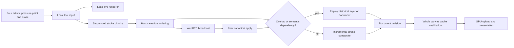
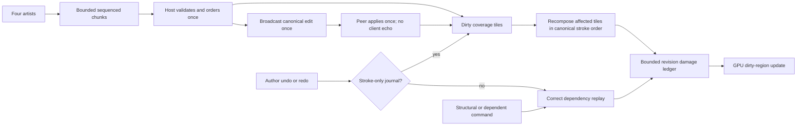
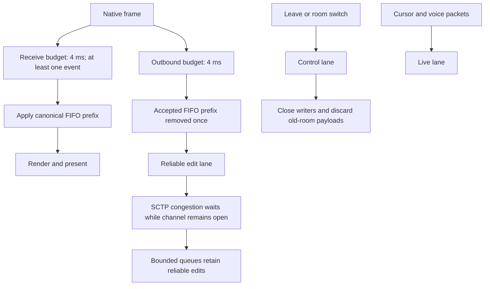

# Overlapping collaboration performance

The stress scenario uses exactly four concurrent artists on one shared layer. They repeatedly paint and erase across the full canvas, with pressure, different brush settings, intersecting paths, burst delivery, and undo/redo while peers continue drawing. Pixel convergence and queue/latency measurements are separate from live native frame measurements.

## Existing path under investigation



## Dirty-tile path



The graphs describe code paths, not proof of performance. Measurements and remaining limits are recorded after the baseline and candidate runs. See [native capture](native-capture.md) for the ScreenCaptureKit/VideoToolbox capture route.

## Backpressure and frame scheduling



The budgets stop between operations; one costly semantic operation can exceed a budget. Reliable queues are bounded, and a permanently non-reading peer can still apply backpressure. Stroke-only author undo/redo uses the coverage-tile path. Layer transforms, structural edits and histories containing generic commands retain correctness-first replay. Automation roundtrip timings measure control dispatch and frame scheduling, not physical pointer-to-photon latency.

## Reproducing the native test

Build `cargo build -p photocraft`, then package its executable into a native `.app` with a valid `CFBundleExecutable`. Reserve four unique loopback control ports in `~/Documents/ports.txt` and save their numbers as a JSON array. An existing room signaling service is needed; this test does not launch or replace it.

```sh
python3 scripts/collaboration_native_stress.py prepare --app /absolute/PhotoCraft.app/Contents/MacOS/PhotoCraft --output /absolute/run --ports /absolute/ports.json --signaling http://127.0.0.1:5548
scripts/native_capture.sh --list
# Substitute only the four test window IDs returned above.
scripts/native_capture.sh /absolute/four-artists.mp4 123,124,125,126 60 30
# Run concurrently with capture, in a second terminal.
python3 scripts/collaboration_native_stress.py run --output /absolute/run --strokes 64 --points 96 --chunk 8 --step-ms 15 --export-after-seconds 60
scripts/native_capture.sh --inspect /absolute/four-artists.mp4 /absolute/review
```

Preparation launches four isolated configs and authenticated controls, creates a shared transparent paint layer over white, and admits three guests. Every artist makes 64 full-canvas crossing gestures, erasing one third of them, with pressure, tilt, rotation, brush sizes, hardness and opacity changes. Every ninth gesture triggers that artist's undo and redo while peers continue. The result checks completed gestures, each author's history, stable canonical revisions, drained bridge queues, nonempty output and matching decoded RGBA pixels. The export delay keeps PNG flattening warnings out of the recording; it does not alter drawing timing. Inspect real changing frames and the capture sidecar before treating a clip as motion evidence.

The headless equivalent is `cargo run -p photocraft-room-server --features doodles --bin collaboration-doodles -- --overlap /absolute/output --rounds 64 --redo --no-frames`. It uses four artists and three actual WebRTC connections, including noisy/scattered and dual brushes, pressure erasing, burst chunks, jitter and replay probes. Use the same flags against the baseline and candidate for latency comparisons.

## Measured results (2026-10-10, Apple Silicon macOS)

| Test | Baseline | Final candidate |
|---|---:|---:|
| Same headless real-WebRTC overlap workload: 16 strokes, 3,072 pressure points, 419 canonical edits | 65.67 s | 20.34 s |
| Same workload canonical acknowledgement p50 / p95 / p99 | 1,142 / 3,018 / 3,355 ms | 319 / 1,177 / 1,475 ms |
| Four native artists, 64 strokes each, 24,576 pressure samples, 56 undo/redo operations: drawing duration | 116.50 s after tile replay but before the undo fix | 49.09 s |
| Native host input roundtrip p50 / p95 / p99 | 19.25 / 40.93 / 1,530 ms before the undo fix | 19.23 / 42.13 / 57.22 ms |
| Native host maximum input roundtrip | 2,272 ms before the undo fix | 72.29 ms |
| Maximum input roundtrip across all four native clients | 2,272 ms before the undo fix | 92.27 ms |

The baseline is the exact PR base `db1569b363524ce8add164a84e98450f8897b0d2`; the candidate source is `5ecd37a17f8481528e728409ed1432771998dad4`. The baseline adds only the identical test harness and read-only buffer telemetry. Earlier measurements against `845a3235` are exploratory and excluded. See the [committed measurement report](evidence/collaboration-overlap-2026-10-10.json).

The identical headless workload improved throughput by 3.23 times. Both versions converge exactly; the final candidate ignores all 12 intentional replay probes, has zero duplicate canonical revisions, zero unacknowledged operations and zero unexpected quiet-period packets. Its acknowledgement metric includes configured arrival jitter, burst scheduling and four engine sessions applied serially in one process; it is not a network-only delay or native pointer latency.

The native candidate completed all 256 gestures, preserved 64 history entries per author, drained bridge queues and matched all four decoded RGBA exports at canonical revision 3,896. The earlier unoptimized native baseline timed out after eight host input batches (7.1 s median, 23.4 s maximum) and disconnected peers; it is a reproduced failure, not a complete percentile comparison. Native measurements use an optimized development build (`opt-level=1`, dependencies `opt-level=2`, no debug symbols), not a release build. Other validation/build jobs were active on this machine.

A second native run completed the same 256 gestures in 43.81 s, again with exact pixels and all queues drained. Host roundtrip p50/p95/p99 was 16.60/27.74/51.65 ms; the slowest request across four clients was 82.76 ms. Hardware H.264 recordings show four native windows for 60.76 s (1,682 fresh captured frames) and host/guest for 45.23 s (1,277 frames), with no capture backpressure drops. Frame counts measure capture, not app FPS.

The 36 MP release brush benchmark also passed at 8-bit, 16-bit, float and CMYK depths. A 200 px textured/scattered stroke in 16-point chunks took 7.93 / 8.06 / 8.59 ms mean per chunk at RGB 8 / 16 / 32-bit, respectively; worst chunks were 12.85 / 13.21 / 14.24 ms. These are single-brush CPU timings, separate from collaboration and physical input-to-display latency.

The real-RTC slow-reader test pauses application receiving for six seconds, then delivers 1,200 packets of 16 KiB in order while both channels remain open. Both old and new transports pass that test; it does not establish that the SCTP buffer threshold stayed exceeded for five seconds. Removing the hard buffer wait timeout is a code-path improvement, while the native stress results establish observed recovery and absence of disconnects for this workload.

Coverage includes native-format tile/oracle tests, pressure/tilt batching and gesture boundaries, growing live prefixes, hidden strokes, checkpoint redo, legacy host deltas, local author history, bounded damage gaps and pending command predictions. Full engine and UI suites, panic hunting, strict Clippy, layer checks, WASM checks and release performance checks are recorded in the PR. No new file-format code or menu command is introduced.

Remaining limits: a costly individual operation may exceed a frame budget; generic command dependencies still require full replay; a permanently non-reading participant can backpressure reliable delivery; guest preview transitions may require one conservative full refresh. This run is four local native clients at 1,024×640, not proof for arbitrary document sizes, device input latency, WAN packet loss, voice acoustics or every tool's interactive performance.
