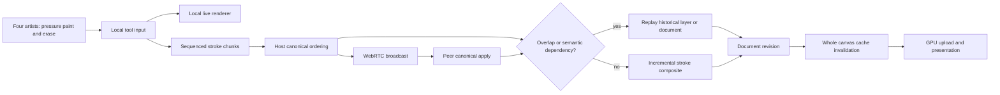
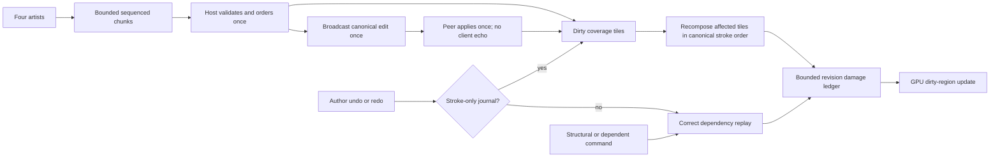
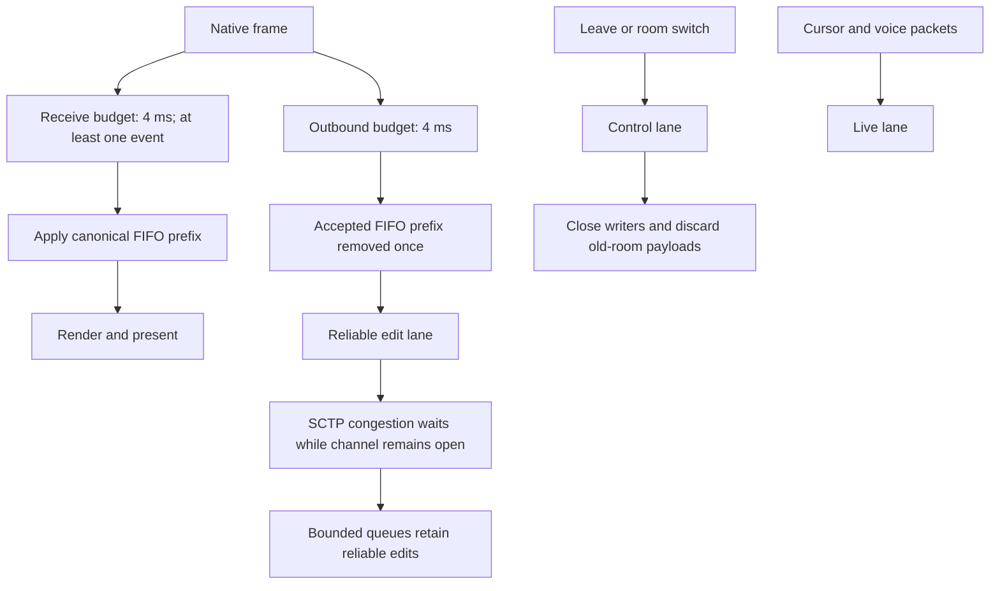
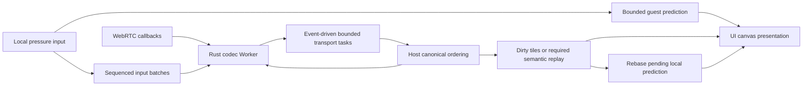
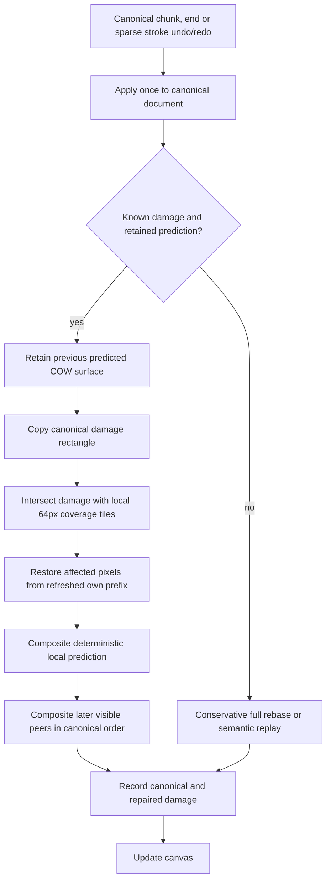
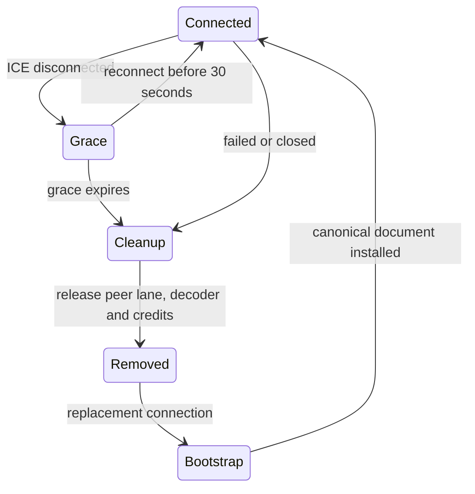
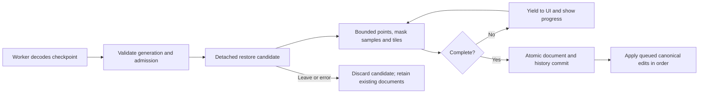

# Overlapping collaboration performance

The stress scenario uses exactly four concurrent artists on one shared layer. They repeatedly paint and erase across the full canvas, with pressure, different brush settings, intersecting paths, burst delivery, and undo/redo while peers continue drawing. Pixel convergence and queue/latency measurements are separate from live native frame measurements.

## Existing path under investigation



## Dirty-tile path



The graphs describe code paths, not proof of performance. Measurements and remaining limits are recorded after the baseline and candidate runs. See [native capture](native-capture.md) for the ScreenCaptureKit/VideoToolbox capture route.

## Backpressure and frame scheduling



The budgets stop between operations; one costly semantic operation can exceed a budget. Reliable queues are bounded, and a permanently non-reading peer can still apply backpressure. Stroke-only author undo/redo uses the coverage-tile path. Layer transforms, structural edits and histories containing generic commands retain correctness-first replay. Automation roundtrip timings measure control dispatch and frame scheduling, not physical pointer-to-photon latency.

## Reproducing the native test

Build `cargo build -p photocraft`, then package its executable into a native `.app` with a valid `CFBundleExecutable`. Reserve four unique loopback control ports in `~/Documents/ports.txt` and save their numbers as a JSON array. An existing room signaling service is needed; this test does not launch or replace it.

```sh
python3 scripts/collaboration_native_stress.py prepare --app /absolute/PhotoCraft.app/Contents/MacOS/PhotoCraft --output /absolute/run --ports /absolute/ports.json --signaling http://127.0.0.1:5548
scripts/native_capture.sh --list
# Substitute only the four test window IDs returned above.
scripts/native_capture.sh /absolute/four-artists.mp4 123,124,125,126 60 30
# Run concurrently with capture, in a second terminal.
python3 scripts/collaboration_native_stress.py run --output /absolute/run --strokes 64 --points 96 --chunk 8 --step-ms 15 --export-after-seconds 60
scripts/native_capture.sh --inspect /absolute/four-artists.mp4 /absolute/review
```

Preparation launches four isolated configs and authenticated controls, creates a shared transparent paint layer over white, and admits three guests. Every artist makes 64 full-canvas crossing gestures, erasing one third of them, with pressure, tilt, rotation, brush sizes, hardness and opacity changes. Every ninth gesture triggers that artist's undo and redo while peers continue. The result checks completed gestures, each author's history, stable canonical revisions, drained bridge queues, nonempty output and matching decoded RGBA pixels. The export delay keeps PNG flattening warnings out of the recording; it does not alter drawing timing. Inspect real changing frames and the capture sidecar before treating a clip as motion evidence.

The headless equivalent is `cargo run -p photocraft-room-server --features doodles --bin collaboration-doodles -- --overlap /absolute/output --rounds 64 --redo --no-frames`. It uses four artists and three actual WebRTC connections, including noisy/scattered and dual brushes, pressure erasing, burst chunks, jitter and replay probes. Use the same flags against the baseline and candidate for latency comparisons.

## Measured results (2026-10-10, Apple Silicon macOS)

| Test | Baseline | Final candidate |
|---|---:|---:|
| Same headless real-WebRTC overlap workload: 16 strokes, 3,072 pressure points, 419 canonical edits | 65.67 s | 20.34 s |
| Same workload canonical acknowledgement p50 / p95 / p99 | 1,142 / 3,018 / 3,355 ms | 319 / 1,177 / 1,475 ms |
| Four native artists, 64 strokes each, 24,576 pressure samples, 56 undo/redo operations: drawing duration | 116.50 s after tile replay but before the undo fix | 49.09 s |
| Native host input roundtrip p50 / p95 / p99 | 19.25 / 40.93 / 1,530 ms before the undo fix | 19.23 / 42.13 / 57.22 ms |
| Native host maximum input roundtrip | 2,272 ms before the undo fix | 72.29 ms |
| Maximum input roundtrip across all four native clients | 2,272 ms before the undo fix | 92.27 ms |

The baseline is the exact PR base `db1569b363524ce8add164a84e98450f8897b0d2`; the candidate source is `5ecd37a17f8481528e728409ed1432771998dad4`. The baseline adds only the identical test harness and read-only buffer telemetry. Earlier measurements against `845a3235` are exploratory and excluded. See the [committed measurement report](evidence/collaboration-overlap-2026-10-10.json).

The identical headless workload improved throughput by 3.23 times. Both versions converge exactly; the final candidate ignores all 12 intentional replay probes, has zero duplicate canonical revisions, zero unacknowledged operations and zero unexpected quiet-period packets. Its acknowledgement metric includes configured arrival jitter, burst scheduling and four engine sessions applied serially in one process; it is not a network-only delay or native pointer latency.

The native candidate completed all 256 gestures, preserved 64 history entries per author, drained bridge queues and matched all four decoded RGBA exports at canonical revision 3,896. The earlier unoptimized native baseline timed out after eight host input batches (7.1 s median, 23.4 s maximum) and disconnected peers; it is a reproduced failure, not a complete percentile comparison. Native measurements use an optimized development build (`opt-level=1`, dependencies `opt-level=2`, no debug symbols), not a release build. Other validation/build jobs were active on this machine.

A second native run completed the same 256 gestures in 43.81 s, again with exact pixels and all queues drained. Host roundtrip p50/p95/p99 was 16.60/27.74/51.65 ms; the slowest request across four clients was 82.76 ms. Hardware H.264 recordings show four native windows for 60.76 s (1,682 fresh captured frames) and host/guest for 45.23 s (1,277 frames), with no capture backpressure drops. Frame counts measure capture, not app FPS.

The 36 MP release brush benchmark also passed at 8-bit, 16-bit, float and CMYK depths. A 200 px textured/scattered stroke in 16-point chunks took 7.93 / 8.06 / 8.59 ms mean per chunk at RGB 8 / 16 / 32-bit, respectively; worst chunks were 12.85 / 13.21 / 14.24 ms. These are single-brush CPU timings, separate from collaboration and physical input-to-display latency.

The real-RTC slow-reader test pauses application receiving for six seconds, then delivers 1,200 packets of 16 KiB in order while both channels remain open. Both old and new transports pass that test; it does not establish that the SCTP buffer threshold stayed exceeded for five seconds. Removing the hard buffer wait timeout is a code-path improvement, while the native stress results establish observed recovery and absence of disconnects for this workload.

Coverage includes native-format tile/oracle tests, pressure/tilt batching and gesture boundaries, growing live prefixes, hidden strokes, checkpoint redo, legacy host deltas, local author history, bounded damage gaps and pending command predictions. Full engine and UI suites, panic hunting, strict Clippy, layer checks, WASM checks and release performance checks are recorded in the PR. No new file-format code or menu command is introduced.

Remaining limits: a costly individual operation may exceed a frame budget; generic command dependencies still require full replay; a permanently non-reading participant can backpressure reliable delivery; guest preview transitions may require one conservative full refresh. This run is four local native clients at 1,024×640, not proof for arbitrary document sizes, device input latency, WAN packet loss, voice acoustics or every tool's interactive performance.

## Browser-host overlap follow-up (2026-10-10)

A second test uses a real browser host and four native automated artists at
1,920×1,080. Each artist paints and erases 16 crossing pressure gestures with
96 samples per gesture and eight-sample input batches, creates an independent
layer during its first gesture, then continues on the same original paint layer.
The harness waits for the creation acknowledgement and reselects the shared
layer before every gesture so delayed layer creation cannot accidentally turn
this into a test of four separate layers.

The deployed `117007ee` browser build and `780744a2` native build reproduced the
reported lag. All four artists completed input, but the original three-second
control-response limit expired while checking convergence. A subsequent check
found one client with 512 queued incoming events, a 744.9 ms collaboration tick,
and a 17,047.3 ms worst tick; three other clients had drained their queues. This
is a reproduced UI stall, not a successful convergence run. Control timings and
collaboration ticks do not measure physical pointer-to-photon latency. Local
proof is retained in `plan/evidence/browser-overlap/baseline-shared/`.

The native transport already owns a dedicated OS thread and a two-thread Tokio
runtime. That does not move canonical document replay or rendering off the GUI
thread. In the browser, eframe continues logic in hidden tabs using a timeout,
but browser timer throttling reduces update frequency. Draining networking only
from those updates creates an additional queue bottleneck.

The follow-up separates transport work from repaint cadence, avoids replaying an
entire journal for proven independent layer creation, and keeps guest strokes
visible while awaiting canonical acknowledgements. Unknown semantic dependencies
retain the conservative replay path. New-room generations reject callbacks and
packets left over from an earlier native room.



Browser connection negotiation remains on Window; the dedicated Rust Worker owns
reliable message encoding, decoding and fragment reassembly. Trunk generates its
loader. Typed structured-clone messages retain large integer IDs as BigInt and
transfer byte buffers. Version/ready checks allow a startup fallback; completion
watchdogs report stalled jobs. FIFO placeholders put checkpoint bytes before
canonical edits that arrive while encoding. IPC credits, fanout reservations and
per-peer lanes prevent normal congestion from turning into dropped edits or
unbounded work. Stable worker assets revalidate on launch.

A targeted native-engine comparison uses a 2,048×1,536 canvas and 16 samples per
case. With a 1,024 px local brush covering 224 tiles, a disjoint remote update's
prediction recomposition median drops from 34.750 ms to 0.176 ms at 8-bit and
from 59.785 ms to 0.329 ms at 32F. Exact surfaces match at every sample. This
measures the prediction step in an optimized dev build on a shared machine;
it excludes canonical application, networking, GPU upload and presentation.
The surrounding engine was compiled before the current-main integration;
the collaboration source is the committed `4e6edf1a` implementation.
[Detailed samples](evidence/collaboration-prediction-disjoint-2026-10-10.json).

Remaining costs include typed-object conversion, checkpoint capture and a single
nonpreemptible engine edit. Prediction keeps the first unacknowledged gesture;
later queued gestures use canonical delivery until that slot is free. A dependent
filter or transform suspends prediction and uses semantic replay. Brush smoothing
can retain samples until movement or release emits a dab. These limits need to
remain distinct from improvements to packet scheduling and disjoint tile reuse.


## Affected-tile prediction repair after dense-room profiling (2026-10-10)

Repeated drawing in the same browser-hosted room exposed a remaining native
stall after the first four-client run had converged. Native samples located the
GUI-thread work in `Collaboration::predict_document`: overlapping canonical
chunks repainted the entire retained local gesture, restored its prefix pixels,
and recomposed later peer strokes. A dedicated networking thread or codec Worker
does not remove that raster work from the GUI thread. The first successful room
run therefore did not establish sustained dense-room responsiveness.

The repair retains the previous predicted layer surface through copy-on-write.
After applying a canonical chunk or stroke end, it copies only the canonical
damage rectangle into that surface. It then restores and recomposes the local
prediction only in its 64px coverage tiles intersecting that rectangle, using the
refreshed canonical prefix. Visible later strokes composite in canonical start
order over those same tiles. Unaffected predicted pixels, including neighbors in
the same 256px raster tile, remain intact. Later peer renderers are reused rather
than cloning their full accumulated coverage for each rebase.

Sparse stroke undo/redo takes the same repair path only when canonical application
reports known damage and has refreshed the relevant prefix caches. Generic
history changes with unknown damage retain full replay. A local End acknowledgement
clears prediction and exposes the authoritative surface; it does not blend the
acknowledged stroke a second time. The damage ledger includes repaired coverage
so canvas updates can clear and redraw the changed pixels.



The native component benchmark compares full prediction rebase and affected-tile
repair against identical state on a 2,048×1,536 canvas. Its local brush is completed
but unacknowledged; the overlapping remote stroke produces real canonical pixel
damage. Exact whole native-format surfaces match for every sample.

| Depth | Brush size / full coverage | Full rebase p50 / p95 / p99 | Four-tile repair p50 / p95 / p99 |
|---|---|---|---|
| RGB 8-bit | 512px / 60 tiles | 10.281 / 14.422 / 14.422 ms | 1.021 / 1.768 / 1.768 ms |
| RGB 8-bit | 1,024px / 224 tiles | 44.085 / 58.634 / 58.634 ms | 1.155 / 3.015 / 3.015 ms |
| RGB 32F | 512px / 60 tiles | 16.785 / 17.340 / 17.340 ms | 2.008 / 2.443 / 2.443 ms |
| RGB 32F | 1,024px / 224 tiles | 63.882 / 68.389 / 68.389 ms | 2.124 / 3.656 / 3.656 ms |

There are 16 samples per case, so p95 and p99 are both the sample maximum.
These are optimized development-build CPU recomposition timings on an Apple M1
Max with concurrent validation work. They exclude canonical application,
networking, GPU upload and presentation, and establish no physical frame-rate or
pointer-latency guarantee. The timed fixture uses one later remote stroke; the
separate dense-history regression below is a correctness test, not a measured
128-history throughput claim. The source stage is merged main `4994d6fb` plus the
tested affected-tile repair. Full precision, disjoint cases and test metadata are
in the [sanitized measurement report](evidence/collaboration-prediction-repair-2026-10-10.json).

The dense correctness fixture starts with 128 historical strokes and keeps a
large local prediction visible while eight later peer strokes arrive. It checks
8-bit, 16-bit and 32F native surfaces, partial alpha, erasing, fractional selection
with zero-coverage holes, and peer undo/redo before and after the local stroke's
canonical start. Own chunk and End acknowledgements and subsequent author undo/
redo converge exactly. Its independent full-coverage oracle clones renderer state
and never resets the production prefix caches between events. Existing regressions
also cover pressure, tilt, rotation, deterministic seeds and transparency locking.

The final five-package library test graph passed: engine 869 tests (14 ignored),
UI 1,007 (8 ignored), and collaboration 17. Strict all-target Clippy passed for
engine, UI, collaboration, web and desktop; the adversarial panic test passed.
The quick release performance task also exited successfully with all four benches,
but that run compiled the earlier `4994d6fb` source before affected-tile repair.
Quick mode does not enforce full-size budgets, and baseline regression comparison
was skipped because its M4 Pro machine class differs from this M1 Max. It therefore
is not validation of this new repair or evidence that every UI operation meets its
budget.

Remaining limits: one unacknowledged gesture occupies the prediction slot; later
queued gestures await canonical delivery. A dependent generic edit can suspend
prediction and require semantic replay. Stroke begin, structural changes and
unknown damage retain conservative full rebase; a large dirty region can still
require substantial work. The four-tile timings do not bound arbitrary brush sizes
or dense overlapping suffixes. Sustained live dense-room responsiveness and
physical input-to-display latency require a separate updated-client run.

### Four-client dense live validation (2026-10-10)

Four isolated native clients joined a real WebRTC room and painted/erased across the same1920×1080 layer over a dense imported test PSD. The first phase submitted32 gestures per artist (128 total,96 pressure/tilt/rotation points per gesture in8-point chunks); the second retained that room and added another128 gestures. Each phase performed three own-author undo/redo pairs per artist.

Both phases drained canonical queues and produced four identical decodedRGBA exports, with32 then64 own-author history entries per client and no reported errors. Drawing lasted31.62s and35.48s; the clients' p95 `ui.pointer` control roundtrips ranged53.38–58.82ms. These measurements include local scheduling and command processing; they are not pointer-to-photon latency or a60FPS guarantee. Lifetime worst collaboration ticks after the second phase were230/422/417/534ms, including checkpoint admission and undo/rebase. A complete8.23s four-window ScreenCaptureKit/VideoToolbox hardware clip was inspected at its beginning, middle, and end (229 accepted frames,2 writer backpressure drops). Sanitized numerical evidence is in [`collaboration-four-native-dense-2026-10-10.json`](evidence/collaboration-four-native-dense-2026-10-10.json).

A separate browser-hosted retest exposed an additional codec watchdog defect: it timed healthy replies while they waited for the Window to apply them. That run failed host confirmation and the pixel/history gates; its input timing and video do not establish convergence. The corrected policy marks receipt in the Worker message callback, retains memory credits until consumption, and distinguishes a proven missing FIFO reply from 30s of worker silence. Arrived replies and healthy queues making progress cannot time out merely because they are old. The final hosted build was retested below; the failed earlier run remains separate evidence.


### Final browser Worker retest (2026-10-10)

The deployed Rust Worker build `d520ec345ef5f722` hosted a 1920×1080 RGB/8 canvas for four native artists. Two consecutive 128-stroke passes retained the same room and journal:42.81s and 47.61s of input, 256 total pressure-sampled paint/erase strokes, 64 history entries per artist, and author-only undo/redo throughout. Both passes drained their queues and produced identical decoded RGBA hashes on all four clients, with no errors. Final canonical revision was 3888; a late browser guest then drew and undid its own stroke, returning all four native canvases to the exact pre-guest hash at revision 3900 while leaving their 64-entry histories intact. The invite opened the actual host canvas, both layers and the full Room dock.

The browser codec Worker remained active. Busy samples show healthy replies received while awaiting engine consumption; all queues drained afterward. Sampled browser collaboration tick p95 was 22.2ms/23.2ms during the first pass and 11.3ms in the second-pass sample. These are bounded sample windows, not whole-run FPS. Worst observed individual host engine apply was 1126ms, so this is correctness and networking progress evidence, not a claim of stall-free rendering. Large dependent generic operations and overlapping history recomposition remain costly. Browser automation focus emulation reports the host visible, so this run does not establish actual hidden-tab pumping.

The second pass has a complete 8.34s hardware H264 ScreenCaptureKit recording (208 accepted frames, 9 writer backpressure drops), inspected at start/middle/end. Sanitized statistics live in `docs/evidence/collaboration-four-browser-dense-2026-10-10.json`; local video and full reports live under `plan/evidence/browser-overlap/final-browser/`.


### Failed peers and reconnect grace

Browser connection and ICE state changes now release failed or closed peers immediately. A disconnected peer gets a recoverable 30-second grace period; reconnecting cancels its deadline. Each connection instance guards its channel callbacks, asynchronous SDP completion and decoded Worker results, so late work cannot target a replacement connection. Replacing a peer retires its partial fragments and requires a fresh checkpoint.

Cleanup removes the connection, its outgoing lane and decoder, releasing only its credits. Decoder cleanup retries if the Worker is busy. SCTP readiness is checked before fragment allocation and send-quota charging. A retained dead lane previously consumed bounded per-frame work and could eventually fill the shared 4,096-job cap, blocking live fanout. The preserved stress host exposed 580 stale jobs after abrupt client termination; this fix addresses that retention, separately from the measured heavy engine-apply stall.



Five peer-policy regressions and four Worker policy regressions passed on Linux. Strict browser WASM Clippy passed for both binaries, all targets and HEIF. Live disconnect validation remains pending at the time of this source entry. Current-main integration separately passed 870 engine, 1,019 UI, 17 collaboration tests, strict native Clippy, adversarial command tests, layers, and 2,080 corpus tests plus 14 imported-format regressions on Linux.

### Guest checkpoint restoration

A fresh Chrome late join on `a1deb2fb` reproduced a 57,050.7 ms synchronous checkpoint apply on a retained 1920×1080 RGB/8 room at revision 3484. The codec Worker took 110 ms, network queues drained, and the maximum logic-frame gap was 57,240 ms. CPU throttling was 1× and network throttling was disabled. These guest measurements explain a join freeze that the earlier host-only samples did not cover. Sanitized evidence is in [`collaboration-checkpoint-join-before-2026-10-11.json`](evidence/collaboration-checkpoint-join-before-2026-10-11.json).

Browser restoration builds a detached candidate with incremental journal validation, renderer construction, and tile composition. Desktop restoration runs the same builder on a dedicated cancellable background thread, including baseline decoding; bounded progress messages keep loading visible. The candidate commits atomically only after successful restoration; cancellation or failure preserves existing documents. Reliable post-checkpoint edits wait until commit and then resume in order, while connection lifecycle events can cancel loading immediately.



The browser work quota limits small rendering units rather than guaranteeing a hard wall-clock cap. Baseline format decoding, individual semantic commands, and the first GPU upload remain coarse operations and require separate measurements. Existing local documents stay detached from the joining room and retain private edits/history throughout loading. Commit waits for active gestures or document dialogs and preserves a private tab edited or selected during loading. Final staged-restore validation is pending.
