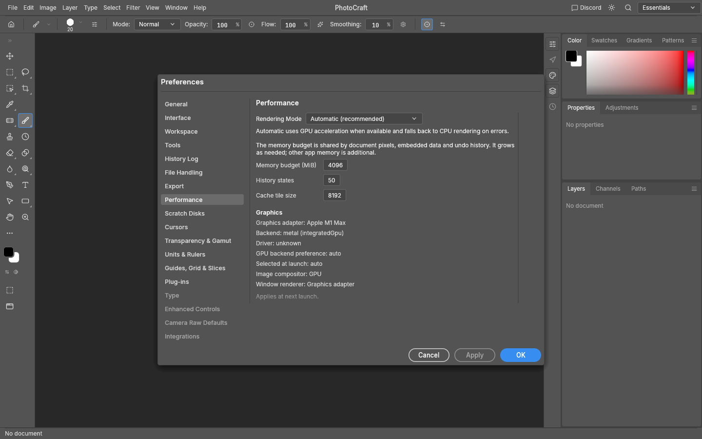
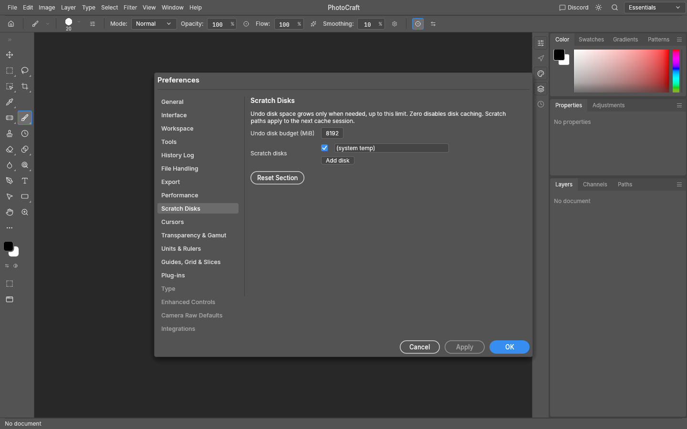

# Undo cache

PhotoCraft keeps current documents and adjacent undo/redo states in shared,
copy-on-write RAM. Older history spills to a session-private scratch directory
under memory pressure. **Unlimited history** and **Use available disk space**
are enabled by default: there is no fixed action-count or 8 GiB scratch ceiling.
Files grow on demand; nothing is preallocated. Physical storage and format safety
checks remain constraints. The managed RAM target remains **4096 MiB**, shared
by the open documents in one Session.

Preferences → Performance controls unlimited retention and the RAM target.
Preferences → Scratch Disks controls available-space retention and scratch paths.
Turning those options off exposes the legacy numeric limits. Explicit older
`prefs.set` calls to `performance.historyStates` or `scratchDisks.budgetMb` select
bounded mode for compatibility. Zero disk budget disables spilling in bounded
space mode. The first enabled path is used, or the system temporary directory.
Paths apply to the next cache session so existing history stays reachable.
The web build remains RAM-only.

In unlimited mode, a full or unavailable disk keeps existing history and reports
an error. New edits pause until storage is repaired and **Retry storage** is
selected. Slow writes can temporarily refuse another edit before its mutation
runs, bounding the backlog without dropping the original or older states.
Explicit purge/close still discards history. States discarded by an earlier
version cannot be reconstructed.

The memory budget measures unique managed document/history pixel payloads and
preserved shared blobs, not process RSS. Current documents, immediately adjacent
history, external snapshots, GPU textures, font data, metadata, filter working
buffers, and allocator overhead can exceed it. A current document is never
silently deleted to satisfy a cache setting. Crossing the RAM target starts
spilling toward a 90% low-water mark to avoid oscillating at the threshold.

## Storage and latency

- RAM snapshots retain existing COW tile sharing. Changes that share every
  payload with current/adjacent states do not trigger redundant scratch writes.
- One bounded worker writes cold snapshots; compression and file cleanup stay
  off the UI thread. Pending snapshots remain accounted as resident data.
- The existing native format writes complete metadata manifests and
  content-addressed, fast lossless zstd tiles/blobs. Unchanged objects are stored
  once across snapshots. Weak allocation caches avoid rehashing live shared
  tiles and reuse them on restoration, without retaining their pixels in RAM.
- Actual compressed objects and manifests count against the disk budget. A
  failed write never publishes a history snapshot. Retired snapshot leases queue
  garbage collection; shared files survive until their final reference expires.
- Current and immediate undo/redo states stay hot when resident. Loading an older
  cold state is explicitly fallible. Native UI undo, redo and direct jumps load
  only the destination on a cancellable worker. Immutable published files
  can be read without waiting on the writer lock. On a read/decode/hash error,
  the document and both history cursors remain unchanged and the command fails.
- Unlimited retention never silently shortens history for quota or backpressure.
  The optional bounded mode can retire oldest states. Failures appear in the
  History panel/status area and through `Session::take_history_cache_notice()`.

Scratch storage is ephemeral, separate from [durable autosave/recovery](recovery.md). Recovery captures cold history handles and writes complete undo/redo checkpoints on its background worker. Normal session
shutdown cleans the private directory. A process crash can leave its temporary
directory behind; automatic crash-leftover cleanup is a follow-up, not permission
to delete another running application's files. Permissions/deletion failures
remain accounted and are reported.

## Vertical scrubber and branches

The narrow History sidebar draws a thumbnail and action label per state, a
stable color and number per branch, and a current-state marker. New actions
scroll into view while the sidebar is already at the bottom. Scrolling up
keeps your browsing position; returning to the bottom resumes following. The
original state remains reachable with **Return to Original**. Dragging highlights a
destination; release commits one jump. Rows are virtualized. Previews are
computed on a worker and cached separately (up to 256 GPU thumbnails), so
painting the panel never hydrates cold documents.

Editing after undo retains the alternative redo path. State IDs and parent/branch
identities survive recovery. Undo/redo follows the selected path at a fork.
`history.inspect` returns state IDs, parents, branches and action labels;
`history.jump {"state":id}` loads one destination, without restoring intervening
states. Failed loads and cancelled jobs leave the document and cursor unchanged.
Shared collaboration documents retain their personal collaboration undo semantics.

Automation uses `prefs.set` / `prefs.get`:

```json
{"values":{"performance.memoryUsageMb":4096,"performance.unlimitedHistory":true,"scratchDisks.useAvailableSpace":true}}
```

`session.inspect` reports actual resident payload bytes, compressed disk bytes,
configured budgets and worker activity. Existing undo, redo, Fade, History Brush,
Fill from History and Reselect preserve their command interfaces; cold restore
errors propagate rather than substituting current pixels.

## Research and implementation choice

[GEGL tile-cache controls](https://developer.gimp.org/api/gegl/property.Config.tile-cache-size.html)
and [swap compression](https://developer.gimp.org/api/gegl/property.Config.swap-compression.html)
support independently bounded RAM and compressed disk tiers.
[Linux zswap](https://www.kernel.org/doc/html/latest/admin-guide/mm/zswap.html)
provides a useful model for demand-grown storage and threshold hysteresis.
[SQLite atomic commit](https://www.sqlite.org/atomiccommit.html) illustrates why
incomplete writes must not become authoritative; no SQLite dependency is needed
for ephemeral immutable scratch objects.

A new LZ4 codec and per-operation replay were considered. Reusing PhotoCraft's
existing pure-Rust native format avoids a second document serializer and preserves
all masks, selections, patterns, video frames and embedded content. It also avoids
a layering violation: ops L2 depends only on an archive interface; engine L5
connects it to format L3. This is an incremental, correctness-first architecture,
not a claim of optimal latency. Files per object remain an opportunity for packed segments and bounded
adjacent-state prefetch.
Benchmark codec and layout changes before selecting them.

## Validation and measurement

`cargo run --release -p photocraft-engine --example history_cache_bench -- --steps 12`
uses a deterministic 24 MP image, a deliberately constrained 128 MiB RAM target,
and compares disk-disabled history with the 8 GiB disk tier. It reports edit,
enqueue, worker-settle and hot/cold undo percentiles, retained steps and actual
RAM/disk payload bytes. Disk-disabled history retains fewer states; it is not an
equivalent-retention performance baseline or proof of a speedup.

Regression tests cover lazy allocation, cross-document sharing, quota rollback,
8/16/32f exact restoration, malformed scratch data, failed writes, no writer-lock
contention during cold reads or snapshot drops, count/budget reduction, redo
invalidation, close/purge cleanup and atomic command failure. The CI workload
publishes a reproducible report independently of the regular native/wasm tests.

Release-mode measurement on Ubuntu CI / Rust 1.99, 2026-10-06
([run](https://github.com/TheSeanLavery/photocraft/actions/runs/37552870516)):

| Metric | Disk disabled | 8 GiB disk tier |
|---|---:|---:|
| Undo steps retained | 1 | 12 (11 archived) |
| Resident managed payloads | 192 MiB | 192 MiB |
| Actual disk payloads + manifests | 0 | 7.36 MiB |
| Edit/enqueue overhead p50 / p95 | 0.265 / 8.585 ms | 0.207 / 0.231 ms |
| Background settle p50 / p95 | 0 / 0 ms | 246.374 / 295.409 ms |
| Cold undo p50 / p95 | unavailable | 37.759 / 47.645 ms |

The current document plus immediately adjacent undo state occupy 192 MiB, so the
128 MiB stress target is exceeded by pinned data even after eviction. Each edit
mutates the full image; the benchmark settles after each edit. The synthetic
repeated texture compresses unusually well. Actual photos, rapid consecutive
edits, larger embedded assets and slower disks need separate measurements; these
numbers do not certify UI latency or a hard process-memory ceiling.

Preferences verified offscreen on Apple M1 Max / Metal:





Coordinator verification: Rust 1.99 local tests pass (617 engine, 29 format,
16 history/ops, 554 UI; 13 existing ignored tests). Strict all-target Clippy for
these four crates passes. The adversarial command check and layering pass;
the dedicated release-mode workload and initial WebAssembly CI pass. Both
preference dialogs were rendered offscreen and visually inspected. Final
cross-platform/corpus CI is linked from the PR.

## Small moves and detailed strokes

Simple integer raster-layer moves retain a shared immutable source and a small
absolute-offset record for each step. A thousand or ten thousand nudges remain
independently undoable: this does not group separate keypresses into one step.
Undo and redo materialize the selected position from the source. Pixel storage
therefore depends on the source and current drawing rather than the number of
nudges. Descriptor storage still grows with the number of steps; `session.inspect`
reports it separately as `historyCache.metadataBytes`. The history-count preference
allows up to 10,000 states; its default remains 50.

Masks, vector content, effect reference positions, and moves near coordinate
saturation retain ordinary exact snapshots. The replay source is resident and
cannot be reclaimed while dependent moves survive. Source handles for subsequent
moves are weak so closing a document or purging history releases them.

Painting keeps exact changed COW tiles. One intricate stroke is one history step
but may retain many tiles; step count is not a byte estimate. The
`undo_edit_costs` example compares 1,000 and 10,000 separate nudges with one long
zigzag brush stroke on a synthetic 6000×4000 canvas, checks stroke undo/redo, and
reports elapsed time, payload bytes, descriptor bytes and scratch bytes. Its initial
art is sparse and its repeated moves alternate direction; it is not a dense-photo
move-performance claim. Regression tests additionally cover monotonic nudges,
negative tile boundaries, interrupted edits, coalesced gestures, source lifetimes
and saturation fallback at U8/U16/F32.

### Direct-jump measurement (2026-10-10)

The deterministic 24 MP, 12-edit workload retained 13 states, with 11 archived.
In the release measurement, sequential traversal took 1090 ms versus 107 ms
for `history.jump` to the original (one document revision). This is a synthetic,
compressible snapshot workload; it excludes native canvas presentation and is
not a promise of 107 ms on every image. [Raw measurement](history-jump-benchmark.json)
records the build flags and bounds. The dev build measured 3683 ms versus 327 ms.
